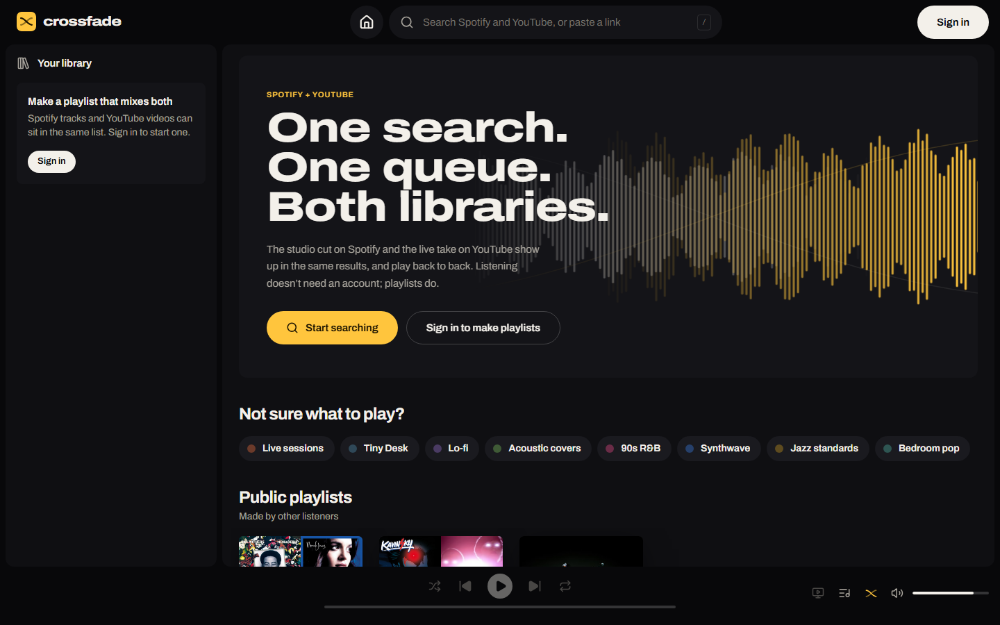
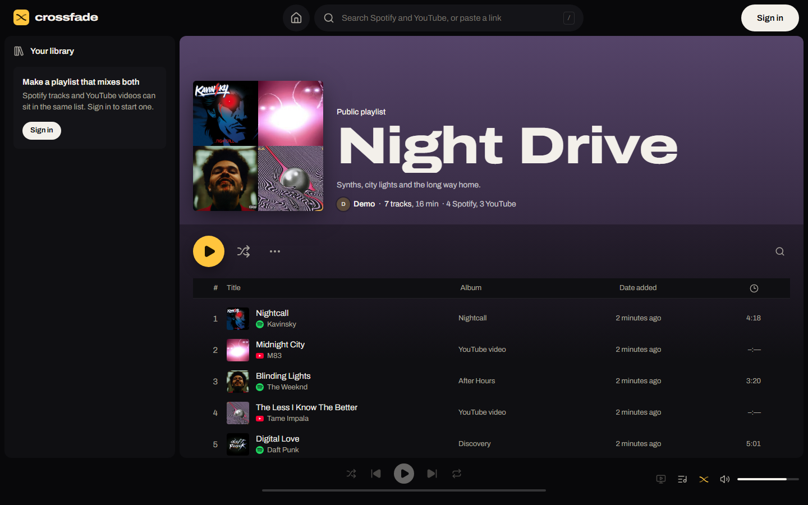
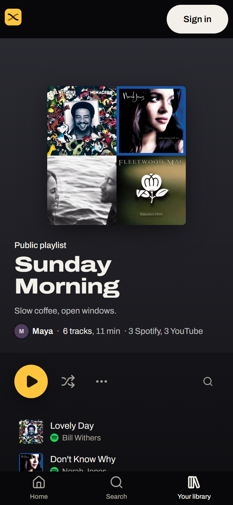

<h1>
  
  Crossfade
</h1>

One search bar and one player for Spotify and YouTube. Live at **[sleeep.dev/crossfade](https://sleeep.dev/crossfade)**.



Your music is split between Spotify and YouTube. Crossfade searches both at once, lets a single playlist hold
tracks from either, and plays straight through it, blending one track into the next, without you switching apps.

## Features

- **One search, both platforms.** Spotify and YouTube results side by side, each labeled with where it plays from.
  Paste a Spotify or YouTube link (a track, video, album or playlist) and it opens right there.
- **Mixed playlists.** The studio cut on Spotify can sit next to a live version on YouTube. The player switches
  platforms on its own.
- **Crossfade.** Blends of up to 12 seconds on an equal-power curve, across platforms too. Tracks that run on from
  each other on the same album still play straight through.
- **Shared playlists.** Invite people by username to add, remove and reorder tracks. Renaming, deleting and changing
  who it's shared with stay with the owner. Public playlists open for anyone with the link, signed in or not.
- **Import.** Bring in the Spotify playlists you own or collaborate on, and your YouTube playlists including Liked
  videos.
- **Liked Songs, history and a home page** that picks up where you left off.
- **Accounts.** Sign in with Spotify or Google and link the other later. Guests can search, play and open public
  playlists without an account.
- **Phone layout** with bottom navigation, a mini player and a full-screen now playing view.
- **Keyboard shortcuts and media keys.** YouTube-style keys (press <kbd>?</kbd> for the list), plus lock screen and
  hardware media controls.

<table>
  <tr>
    <td width="68%"></td>
    <td width="32%"></td>
  </tr>
</table>

## How playback works

Crossfade never downloads or proxies audio. Everything plays through each platform's official player, which
Crossfade drives and fades:

| Track                                        | Plays through                                                                     |
| -------------------------------------------- | --------------------------------------------------------------------------------- |
| YouTube video                                | YouTube IFrame Player (two of them, so one can fade in while the other fades out) |
| Spotify track, listener has Spotify Premium  | Spotify Web Playback SDK: full tracks in the browser                              |
| Spotify track, guest or free Spotify account | Spotify embed: full tracks if signed in to Spotify in the browser, else previews  |

More in [docs/ARCHITECTURE.md](docs/ARCHITECTURE.md).

## Built with

[Next.js 15](https://nextjs.org) (App Router) · TypeScript · [tRPC 11](https://trpc.io) ·
[Prisma 6](https://www.prisma.io) with MySQL 8.4 · [Auth.js 5](https://authjs.dev) · [Tailwind CSS 4](https://tailwindcss.com) ·
Radix UI · Zustand · dnd-kit · Vitest · GitHub Actions · Docker

## Running it locally

You need Node.js 22 or newer and Docker (for MySQL; any MySQL 8 works).

```bash
npm install
cp .env.example .env
```

In `.env`, set `AUTH_SECRET` (generate one with `npx auth secret`) and `AUTH_DEV_LOGIN="true"`. Then:

```bash
docker compose up -d
npm run db:migrate
npm run db:seed
npm run dev
```

Open **http://127.0.0.1:3000/crossfade**. Use `127.0.0.1` rather than `localhost`: Spotify no longer accepts
`localhost` redirect URIs, and sign-in cookies are per host.

The developer login on the sign-in page takes any username, so you can try playlists and sharing between two
accounts in two browsers. The seed adds three listeners (`demo`, `sam` and `maya`) and three playlists that mix
both platforms, one of them shared.

### API keys

None are needed to look around: seeded playlists play, and pasted YouTube links resolve without a key. Each key
turns on more:

| Variables                                | Turns on                                                                                        |
| ---------------------------------------- | ----------------------------------------------------------------------------------------------- |
| `AUTH_SPOTIFY_ID`, `AUTH_SPOTIFY_SECRET` | Spotify search and links (for guests too), Sign in with Spotify, playlist import, full playback |
| `YOUTUBE_API_KEY`                        | YouTube search, trending videos, video lengths up front                                         |
| `AUTH_GOOGLE_ID`, `AUTH_GOOGLE_SECRET`   | Sign in with Google, YouTube playlist import                                                    |

Setting up each one is covered in [docs/DEPLOYMENT.md](docs/DEPLOYMENT.md#2-spotify-and-google-apps).

## Scripts

| Command                | What it does                                                   |
| ---------------------- | -------------------------------------------------------------- |
| `npm run dev`          | Development server with Turbopack                              |
| `npm run build`        | Production build (standalone output, used by the Docker image) |
| `npm test`             | Unit tests (Vitest); `npm run test:watch` while working        |
| `npm run check`        | ESLint and the TypeScript compiler                             |
| `npm run format:write` | Prettier                                                       |
| `npm run db:migrate`   | Apply migrations                                               |
| `npm run db:generate`  | Create a migration after changing `prisma/schema.prisma`       |
| `npm run db:seed`      | Demo listeners and playlists (safe to run again)               |
| `npm run db:studio`    | Browse the database                                            |

CI runs lint, typecheck, the Prettier check, the tests and a production build on every push, and applies every
migration to an empty MySQL to catch drift from the schema.

## Project layout

```
src/
  app/                  routes: home, search, library, playlists, profiles, import, settings, sign in
    api/                Auth.js, tRPC, playlist covers, health check
  components/           UI, grouped by area (player, playlists, shell, tracks, ui)
  lib/
    player/             queue, store, crossfade controller, platform decks, shortcuts
  server/
    adapters/           Spotify and YouTube API clients behind one interface
    api/routers/        tRPC routers
    auth/               Auth.js configuration and OAuth scopes
prisma/                 schema, migrations and the demo seed
deploy/                 production Docker Compose and entrypoint
docs/                   user guide, architecture, deployment
```

## Documentation

- [User guide](docs/USER_GUIDE.md): everything a listener can do
- [Architecture](docs/ARCHITECTURE.md): how the pieces fit together, and why
- [Deployment](docs/DEPLOYMENT.md): running it at sleeep.dev/crossfade, or anywhere else

## Limits worth knowing

- **Spotify Development Mode.** Since early 2026, an app in Development Mode is limited to five Spotify accounts,
  added by hand in the developer dashboard, and its owner needs Premium. Anyone else can still use Crossfade as a
  guest or with Google; reaching every Spotify user takes Spotify's extended quota review.
- **Full Spotify tracks need Premium**, because that's what the Web Playback SDK requires. Everyone else gets the
  Spotify embed.
- **YouTube allows 10,000 API units a day**, and a search costs 100. Crossfade caches responses and stops new
  searches at 8,500 units, so imports and link lookups keep working for the rest of the day.

## Team

CSC 5750 (Principles of Web Technology) term project by Mohamed Aloudi, Venkat Yenduri, Armaan Bhandal and
Tyler Warwick.
