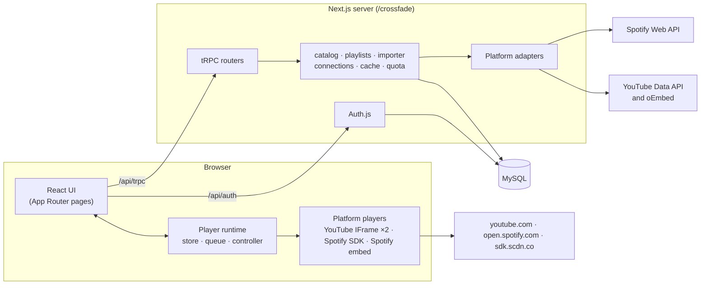
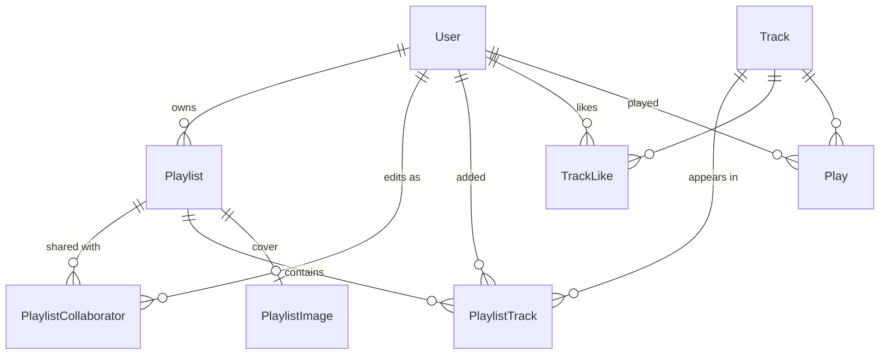
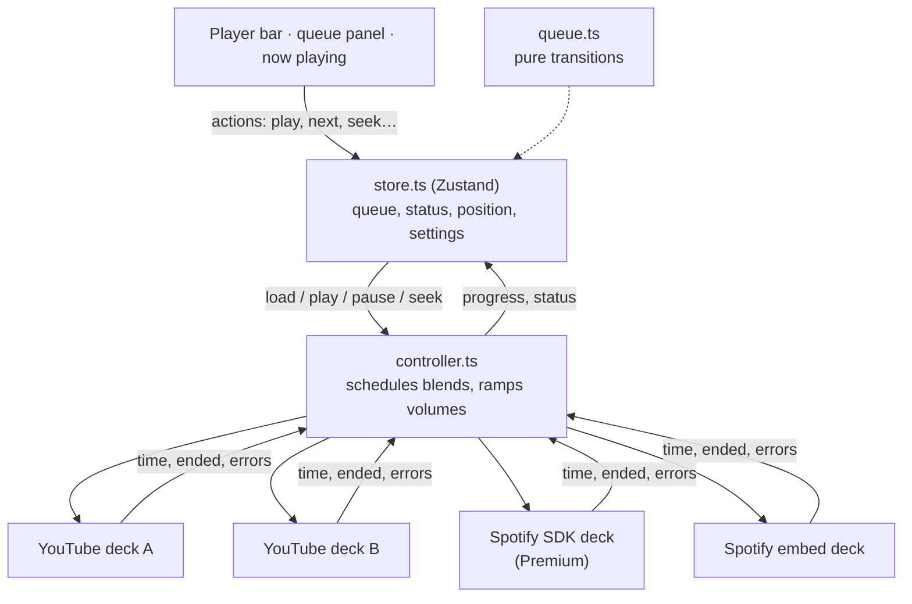

# Architecture

Crossfade is one Next.js application: React on the client, a tRPC API on the server, MySQL through Prisma, and
Auth.js for accounts. This document covers how the parts fit together and why they're built the way they are. The
[README](../README.md) has the feature list and setup.

## Where things live

| Path                     | What's there                                                                                           |
| ------------------------ | ------------------------------------------------------------------------------------------------------ |
| `src/app`                | Routes. Server components fetch the first data; client components take over from there.                |
| `src/components`         | UI by area: `player`, `playlists`, `shell` (sidebar, top bar, bottom nav), `tracks`, `ui`.             |
| `src/lib`                | Code shared by client and server: types, link parsing, formatting.                                     |
| `src/lib/player`         | The player: queue, store, crossfade controller, platform decks, persistence.                           |
| `src/server/api/routers` | tRPC routers: `search`, `playlist`, `library`, `likes`, `history`, `home`, `user`, `account`, `track`. |
| `src/server`             | Everything server-only: adapters, catalog, auth, caching, quota, rate limits.                          |
| `prisma`                 | Schema, migrations, demo seed.                                                                         |

Modules under `src/server` import `server-only`, so the build fails if one ends up in a client bundle.

## One shape for every track

The whole app shares one track type, `TrackData` in `src/lib/types.ts`. The platform adapters in
`src/server/adapters` turn Spotify and YouTube responses into it, and nothing outside the adapters knows what either
API returns. The adapters do the cleanup a listener would otherwise see: YouTube titles lose "(Official Video)" and
similar tags, "Artist - Title" uploads are split, and channel names like "DaftPunkVEVO" or "Daft Punk - Topic"
become "Daft Punk". Podcast episodes, local files and region-locked tracks are dropped on the Spotify side.

The `Track` table is the catalog: one row per platform track, unique on `(source, sourceId)`, shared by every
playlist, like and play that refers to it. The client only ever sends references (`{ source, sourceId }`), and
`ensureTracks` in `src/server/catalog.ts` looks up anything it hasn't seen, so a client can't put made-up titles or
artwork into someone's playlist.

## Search and external APIs

A search runs Spotify and YouTube in parallel through `settle`, which turns a failure into a status instead of
failing the request. If YouTube is out of quota, Spotify results still come back, and the UI says why YouTube is
missing. Pasted links skip search: `parseMusicLink` recognizes the URL forms people actually copy (short links,
mobile and music.youtube.com URLs, `intl-xx` Spotify paths, `spotify:` URIs) and the server resolves just that
item.

Two limits shape this code:

- **YouTube's quota.** The Data API allows 10,000 units a day, and one search costs 100. `quota.ts` counts units in
  the `ApiQuota` table by Pacific-time day (when Google resets it) and stops new searches at 8,500, keeping the
  rest for imports and single-video lookups. Video links fall back to oEmbed, which costs nothing, so pasted links
  keep working when the quota is spent and even with no API key.
- **Repeated work.** `cache.ts` keeps responses in the `ApiCache` table behind a 500-entry in-memory LRU, and
  concurrent requests for the same key share one upstream call. Searches are kept for 6 hours (Spotify) and a day
  (YouTube); track metadata for a week; trending videos for 4 hours.

Every procedure that costs something is rate limited per user, or per IP for guests (`rate-limit.ts`): for
example, 40 searches a minute and 6 imports a minute.

## Accounts

Auth.js 5 with the Prisma adapter. People sign in with Spotify or Google and can link the other one later from
Settings. A Google sign-in may attach to an existing account with the same email, because Google only hands out
verified addresses; the reverse isn't allowed, since Spotify doesn't promise that.

- **Sessions** are JWT cookies holding the user id, valid for 30 days. They're named `crossfade.*` and scoped to
  `Path=/crossfade`, so other apps on sleeep.dev never receive them.
- **OAuth tokens** stay on the server, in the `Account` table. `connections.ts` hands out a valid access token,
  refreshing it a minute before it expires, with one refresh in flight per account. A revoked token becomes a
  "Reconnect" prompt in the UI. The only token that reaches the browser is the short-lived one the Spotify SDK
  needs, from `account.spotifyPlaybackToken`.
- **Scopes are asked for when they're needed.** Google sign-in requests only `openid email profile`; read access to
  YouTube is requested when someone opens YouTube import. Spotify asks for playlist read access (for import) and the
  streaming scopes the Web Playback SDK needs.
- OAuth flows use PKCE. The developer login (a username-only form for local testing) only exists
  when `AUTH_DEV_LOGIN=true` and `NODE_ENV` isn't production.

## Playlists and sharing

Everyone who opens a playlist gets a role from `roleFor` in `src/server/playlists.ts`, and every procedure checks it
on the server:

| Can they...                                 | Owner | Collaborator |  Anyone else   |
| ------------------------------------------- | :---: | :----------: | :------------: |
| Open and play it                            |  Yes  |     Yes      | Only if public |
| Add, remove and reorder tracks              |  Yes  |     Yes      |       No       |
| Rename it, change the description or cover  |  Yes  |      No      |       No       |
| Make it public or private, invite or remove |  Yes  |  Leave only  |       No       |
| Delete it                                   |  Yes  |      No      |       No       |

Track order is a 0-based `position` column with no gaps. Every change that touches order runs in a transaction that
first locks the playlist row (`SELECT ... FOR UPDATE`), so two collaborators dragging tracks at the same moment
can't interleave their updates. A playlist holds up to 2,000 tracks and 20 collaborators.

Imports are copies. Importing a Spotify or YouTube playlist (or saving an album opened from a link) creates an
ordinary Crossfade playlist that remembers where it came from, and later changes on the platform don't follow it.
Spotify only lets an app read the tracks of playlists the user owns or collaborates on, so the import page lists
the playlists someone merely follows separately instead of failing on them.

**Covers.** The browser crops an uploaded image to a square JPEG of at most 640 pixels and about 480 KB before
sending it. The server checks the size and the JPEG start and end markers, stores the bytes in `PlaylistImage`, and
serves them from `/api/covers/[id]`. The URL carries a version from `coverUpdatedAt`, so responses can be cached
forever and a new upload still shows up at once. Covers of private playlists are only served to people with a
role. Without an upload, a cover is the first track's artwork, or a 2×2 mosaic once there are four different ones.

## The player

The player is the part with the most moving pieces. It lives in `src/lib/player`, outside React, and React
components subscribe to it.

**The queue** (`queue.ts`) is plain data and pure functions: next, previous, shuffle, repeat, "Add to queue" and
"Play next". Queued tracks play before the rest of the context (playlist, album, search results) and the context
resumes where it left off, as on Spotify. Turning shuffle on keeps the current track and shuffles everything after
it; turning it off returns to the real order at the same track. Being pure, it's the most heavily tested module.

**Decks** (`decks/`) wrap each platform's player behind one interface: load, play, pause, seek, set volume, and
events for time, end and errors.

- YouTube uses the IFrame Player API, with two players so one can fade in while the other fades out.
- Spotify Premium listeners get the Web Playback SDK, which makes the tab a Spotify Connect device. Tracks are
  started on it through the Web API. The SDK has no "ended" event, so the deck infers one from the player state.
- Everyone else gets the Spotify embed, which plays full tracks for people signed in to Spotify in the browser and
  30-second previews otherwise.

**The controller** (`controller.ts`) ticks four times a second. When the time left in a track drops to the
crossfade length (0 to 12 seconds, 5 by default), it starts the next track on a second deck and moves both volumes
every 50 ms along an equal-power curve: the outgoing track at cos(t·π/2), the incoming one at sin(t·π/2). The
squares of the two always add up to one, so the mix stays as loud through the middle as at either end, where a
linear fade would dip by about 3 dB. Not every pair of tracks can overlap, and the controller works around each
case:

| Handoff                                       | What happens                                                              |
| --------------------------------------------- | ------------------------------------------------------------------------- |
| YouTube to YouTube, or across platforms (SDK) | Full crossfade                                                            |
| Spotify SDK to Spotify SDK                    | The SDK plays one stream per account: fade out, then fade the next one in |
| To or from the Spotify embed                  | The embed has no volume control: a clean cut                              |
| Next track continues the same album           | No blend at all, so live albums and DJ mixes play as sequenced            |
| Tracks too short for two fades                | No blend                                                                  |

**The media surface** (`components/player/media-surface.tsx`) solves a layout problem. Video and embeds have to be
visible, and YouTube requires its player to be at least 200×200 pixels. The video can appear in the desktop dock,
the right-hand panel, the phone mini player or the full-screen view, but moving an iframe in the DOM reloads it and
restarts playback. So the iframes never move: they sit in one fixed layer that, every animation frame, is placed
over whichever "slot" is mounted with the highest priority.

**Around it:** settings and the last queue are saved to `localStorage` (by hand rather than with Zustand's persist
middleware, because the position updates four times a second). The Media Session API feeds the lock screen and
hardware media keys. A play counts toward history after 30 seconds, or half of a shorter track, once per queue
entry. Keyboard shortcuts follow YouTube's.

## Front end

- **Rendering.** Pages are server components that prefetch their tRPC queries and hand the cache to the client
  (`HydrateClient`), so the first paint has data and the client doesn't refetch it. Everything interactive is a
  client component on TanStack Query.
- **Layout.** On desktop, three columns: library sidebar, main view, and a right panel for the queue, now playing
  and video. On tablets the panel overlays the main view. Phones get a bottom tab bar, a mini player above it and a
  full-screen now playing sheet that can be dragged down to close. Rows use container queries, so a track table
  adapts to the space it has rather than to the window.
- **Look.** Dark, with one amber accent (`#ffc53d`) and Archivo for type, its expanded width for display headings.
  Playlist headers take their color from the cover art, sampled in a canvas.
- **Accessibility.** Menus, dialogs and sliders are Radix primitives with keyboard support and focus management.
  Icon buttons have labels, the phone sheet moves focus in when it opens and back when it closes, and
  animations respect `prefers-reduced-motion`.

## Testing and CI

Unit tests (Vitest) cover the code where mistakes are easy and the rules are clear: the queue, the crossfade curve
and album detection, link parsing, YouTube title cleanup, the Spotify and YouTube mappings, cover validation, rate
limiting, scopes and formatting. Run them with `npm test`.

GitHub Actions runs lint, the TypeScript compiler, Prettier, the tests and a production build on every push and
pull request. A second job applies every migration to an empty MySQL 8.4 and fails if the result differs from
`schema.prisma`.

## Security notes

- OAuth tokens never leave the server, apart from the short-lived Spotify SDK token. Session cookies are
  `HttpOnly`, `SameSite=Lax` and `Secure` over HTTPS.
- Procedures validate their input with Zod and check the caller's role on the server. The ones that cost
  something (search, imports, invites, uploads) are rate limited.
- Uploaded covers must be real JPEGs under 512 KB, and are served with `nosniff` and a `default-src 'none'`
  content security policy.
- Responses carry `X-Content-Type-Options`, a strict referrer policy and a permissions policy that only lets the
  YouTube and Spotify frames autoplay.
